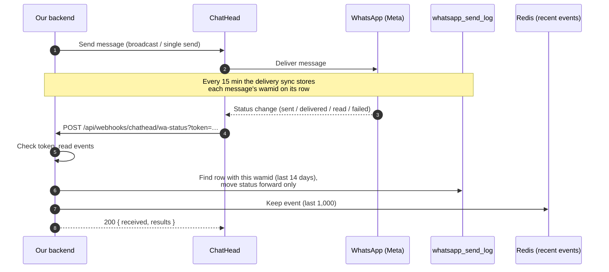
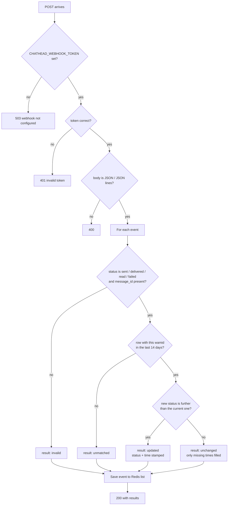

# WhatsApp message status webhook (ChatHead)

ChatHead calls this webhook every time the status of a WhatsApp message changes: **sent**, **delivered**, **read** or **failed**. The backend writes that status onto the matching row in `whatsapp_send_log`, so delivery and read numbers are up to date without waiting for the 15-minute delivery sync.

- **Code:** [`src/routes/chatheadWebhook.ts`](../src/routes/chatheadWebhook.ts), mounted in [`server.ts`](../server.ts)
- **Tests:** [`tests/route-chatheadWebhook.test.ts`](../tests/route-chatheadWebhook.test.ts)
- **Database:** none to add. It only updates existing columns of `whatsapp_send_log`.

---

## Endpoints

| Method | URL | Purpose |
|---|---|---|
| `POST` | `https://promotions.raynatours.com/api/webhooks/chathead/wa-status?token=<TOKEN>` | ChatHead sends status events here |
| `GET` | `https://promotions.raynatours.com/api/webhooks/chathead/wa-status/recent?token=<TOKEN>&limit=50` | Shows the last events received, for checking (up to 200) |

The token can also be sent as the header `X-Webhook-Token: <TOKEN>` instead of `?token=`.

`/api/webhooks/*` needs no login. The **token is the only protection**, because ChatHead's events carry no signature, so share it only with ChatHead. The route sits before the API rate limiter, because status events arrive in bursts.

---

## Switching it on

The webhook is **off until a token is set**. Without one, every call gets `503 webhook not configured` and nothing is written.

1. Generate a token: `openssl rand -hex 24`
2. On the EC2, add it to `backend/.env`:
   ```
   CHATHEAD_WEBHOOK_TOKEN=<token>
   ```
3. Restart the backend so it reads the setting:
   ```bash
   cd ~/Data_pipeline
   docker compose up -d --force-recreate backend
   ```
   Do this outside the send windows (B2B 11:45–13:20, B2C 16:00–22:00).
4. Give ChatHead the full `POST` URL, including `?token=…`.

To switch it off, remove the line from `.env` and restart the backend.

---

## Event format

One event per call as a JSON object, several as a JSON array, or one JSON object per line (`Content-Type: application/x-ndjson`). At most 500 events are processed per call.

```json
{"type":"status","status":"sent","message_id":"wamid.HBgMOTE4NDEyMDE0NDcxFQIAERgSRDM5QkE4ODI1Q0E0NjM1RDgwAA=="}
{"type":"status","status":"delivered","message_id":"wamid.HBgMOTE4NDEyMDE0NDcxFQIAERgSRDM5QkE4ODI1Q0E0NjM1RDgwAA=="}
{"type":"status","status":"read","message_id":"wamid.HBgMOTE4NDEyMDE0NDcxFQIAERgSRDM5QkE4ODI1Q0E0NjM1RDgwAA=="}
{"type":"status","status":"failed","message_id":"wamid.HBgMOTE4NDEyMDE0NDcxFQIAERgSRDM5QkE4ODI1Q0E0NjM1RDgwAA==","reason":"reason text"}
```

| Field | Required | Meaning |
|---|---|---|
| `type` | no | Must be `status` if present |
| `status` | yes | `sent`, `delivered`, `read` or `failed` |
| `message_id` | yes | WhatsApp message ID (`wamid.…`). It's the only way to find the message, because events carry no phone number or broadcast ID. |
| `reason` | no | Why a message failed (stored up to 500 characters) |

---

## Flow



### What happens to one event



---

## Rules for updating a message

Statuses only ever move **forward**:

| Status | Rank | What is written |
|---|---|---|
| `sent` | 1 | `status='sent'`, `sent_at` (if empty) |
| `delivered` | 2 | `status='delivered'`, `delivered_at` (and `sent_at` if empty) |
| `read` | 3 | `status='read'`, `read_at` (and `delivered_at` / `sent_at` if empty) |
| `failed` | between 1 and 2 | `status='failed'`, `error` and `delivery_reason` = `reason`, only if the message was not yet delivered |

- A late `delivered` after `read` doesn't change the status. A time that's still empty is filled in, but an existing one is never overwritten.
- Receiving the same event twice is harmless.
- `failed` after `delivered` or `read` is ignored.
- Times are when **we receive** the event, because the events carry no timestamp.

---

## Responses

| Code | When | Body |
|---|---|---|
| `200` | Valid token and body, whether or not anything matched | `{"success":true,"received":N,"results":[{"message_id","status","result"}]}` |
| `400` | Body isn't JSON or JSON lines | `{"success":false,"error":"body must be a status event (JSON)"}` |
| `401` | Wrong or missing token | `{"success":false,"error":"invalid token"}` |
| `503` | `CHATHEAD_WEBHOOK_TOKEN` not set | `{"success":false,"error":"webhook not configured"}` |

`result` per event:

| result | Meaning |
|---|---|
| `updated` | The row was found and its status moved forward |
| `unchanged` | The row was found, but its status was already at or beyond this one |
| `unmatched` | No row with that `wamid` in the last 14 days (see below) |
| `invalid` | Unknown status, missing `message_id`, or `type` not `status` |

A valid call always gets `200`, so ChatHead never retries in a loop. A database error on one event is logged and counted as `unmatched`; the rest of the call still goes through.

---

## When an event is "unmatched"

The webhook can only update a message we've logged **and** whose `wamid` we know:

| Send type | Logged in `whatsapp_send_log`? | `wamid` known when? | Webhook result |
|---|---|---|---|
| Journey / broadcast / test send | Yes | After the next 15-minute delivery sync | `unmatched` before the sync, `updated` after it |
| OTP (single send, channel 191) | **No** (by design, nothing is stored for OTP) | Never | Always `unmatched` |
| Message older than 14 days | Yes | Yes | `unmatched` (outside the search window) |

Unmatched events aren't lost: they're in the recent-events list (`GET …/recent`). The delivery sync still fills in broadcast results as before.

---

## Testing

```bash
URL="https://promotions.raynatours.com/api/webhooks/chathead/wa-status"
TOKEN="<token>"
WAMID="wamid.HBgMOTE4NDEyMDE0NDcxFQIAERgSRDM5QkE4ODI1Q0E0NjM1RDgwAA=="

# wrong token → 401
curl -s -X POST "$URL?token=wrong" -H 'Content-Type: application/json' \
  -d '{"type":"status","status":"sent","message_id":"'$WAMID'"}'

# one event → 200 (unmatched: sample message isn't in our log)
curl -s -X POST "$URL?token=$TOKEN" -H 'Content-Type: application/json' \
  -d '{"type":"status","status":"delivered","message_id":"'$WAMID'"}'

# all four, one per line
printf '%s\n' \
 '{"type":"status","status":"sent","message_id":"'$WAMID'"}' \
 '{"type":"status","status":"delivered","message_id":"'$WAMID'"}' \
 '{"type":"status","status":"read","message_id":"'$WAMID'"}' \
 '{"type":"status","status":"failed","message_id":"'$WAMID'","reason":"reason text"}' |
curl -s -X POST "$URL?token=$TOKEN" -H 'Content-Type: application/x-ndjson' --data-binary @-

# what was received
curl -s "$URL/recent?token=$TOKEN&limit=10"
```

To see a real `updated`, use a `wamid` from a recent test send to your own number (`SELECT wamid FROM whatsapp_send_log WHERE phone = '<your number>' AND wamid IS NOT NULL ORDER BY id DESC LIMIT 1;`). Send `delivered`, then `read`: both should be `updated`. Then send `delivered` again: it should be `unchanged`.

Automated tests: `npx vitest run tests/route-chatheadWebhook.test.ts`

---

## Troubleshooting

| Symptom | Check |
|---|---|
| ChatHead gets `503` | `CHATHEAD_WEBHOOK_TOKEN` missing from `backend/.env`, or the backend wasn't restarted after adding it |
| ChatHead gets `401` | The token in the URL doesn't match `.env` exactly |
| ChatHead gets `404` | Backend not deployed with this code yet |
| Everything is `unmatched` | Normal for OTP and for broadcasts before the 15-minute sync. Check `GET …/recent`. |
| Want to see activity | `docker compose logs --since 1h backend \| grep "WA webhook"`. Each call logs `updated / unchanged / unmatched / invalid` counts. |
